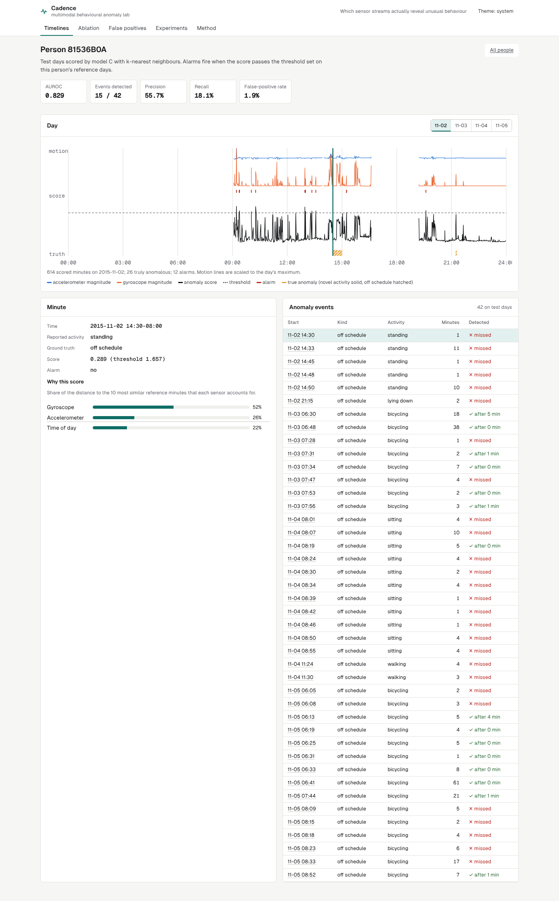
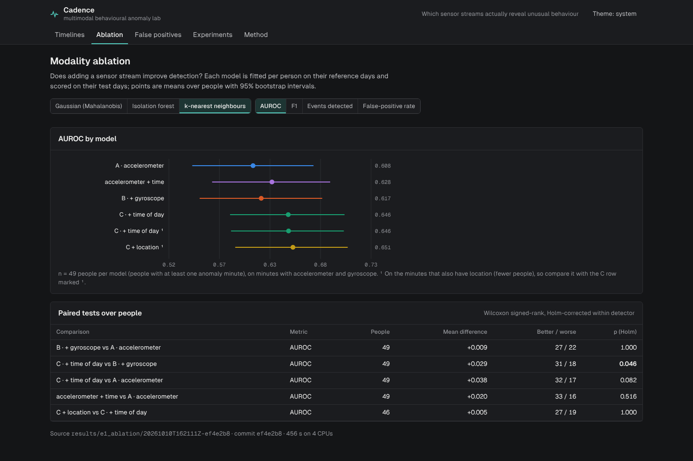
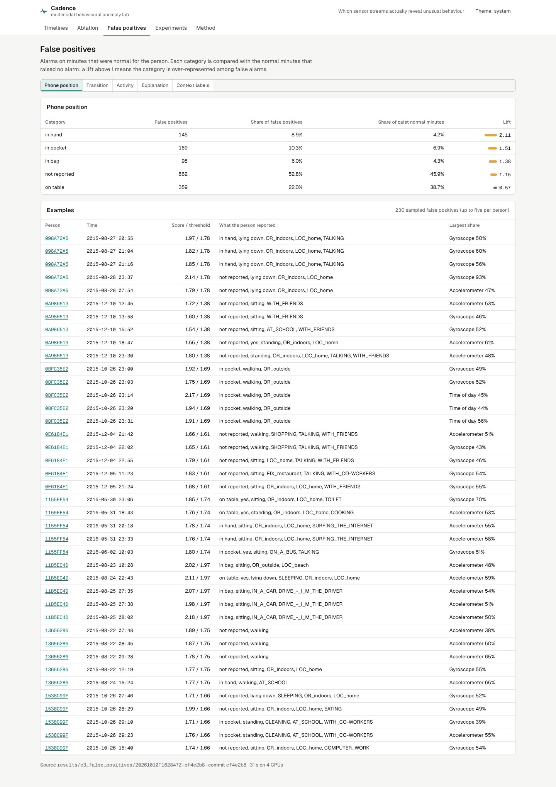
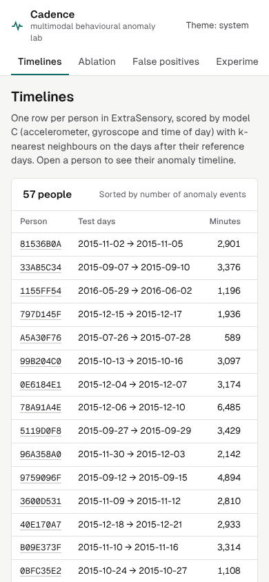

# Multimodal behavioural anomaly detection

Which sensor streams actually reveal unusual behaviour? This lab detects abnormal patterns in
everyday phone-sensor data and runs a **modality ablation** to find out what each stream adds:

| Model | Streams |
|---|---|
| A | accelerometer |
| B | accelerometer + gyroscope |
| C | accelerometer + gyroscope + time of day |
| extensions | accelerometer + time; C + location |

Data: ExtraSensory, 60 people, 377,346 minutes of daily life. Every number below was produced by
the code in this repository; interpretation is in [docs/REPORT.md](docs/REPORT.md) and all tables
in [docs/generated/results.md](docs/generated/results.md).

## Results

kNN detector, mean over people with a 95% bootstrap interval (49 people with anomalies):

| Model | AUROC | Events detected | False-positive rate |
|---|---:|---:|---:|
| A · accelerometer | 0.608 [0.543, 0.673] | 0.241 | 0.019 |
| B · + gyroscope | 0.617 [0.551, 0.682] | 0.242 | 0.016 |
| C · + time of day | 0.646 [0.584, 0.706] | 0.234 | 0.016 |

- **The gyroscope adds nothing measurable** over the accelerometer (B vs A +0.009 AUROC, not
  significant, for all three detectors).
- **Time of day helps, a little, and only for timing anomalies.** C vs B +0.029 (kNN, Holm p =
  0.047) and +0.008 (Gaussian, p = 0.029). Novel activities are easy for every model (AUROC
  0.85–0.87); activities at an unusual time are barely detectable (0.55–0.59), and that is where
  time helps (+0.037, p = 0.017).
- **False alarms come from normal but motion-rich contexts:** walking (lift 3.45), outdoors (4.26),
  driving (2.34), more than from phone handling (in hand 2.11) or transitions (2.57).
- **Persistence rules don't pay:** "2 of 3 minutes" cuts false alarms 45% but detected events 37%;
  a stricter single-minute threshold beats it on both.
- **Robustness:** every A/B/C difference keeps its direction under four alternative choices;
  significance of the time effect depends on fusion weighting and kNN k.

Detection overall is weak (AUROC about 0.6), and the report says so.

## What is built

```
ExtraSensory streams ─► synchronisation ─► features ─► fusion ─► detector ─► score ─► alarm
 (acc, gyro, location,   (local time,       (per-minute  (robust      (kNN, isolation  (threshold from
  timestamps, labels)     availability)      + hour)      scaling,     forest,          reference days)
                                                          equal block   Gaussian)
                                                          weights)
```

- `behavlab.data`: download with pinned SHA-256, per-person loading, local time, sensor
  availability masks, the data card.
- `behavlab.truth`: ground truth from each person's own reports (novel activity, off schedule),
  fixed before any detector runs; anomaly events.
- `behavlab.fusion`, `behavlab.detectors`: block-weighted fusion; kNN with exact per-sensor
  explanation shares, isolation forest, Gaussian; thresholds from cross-fitted reference scores.
- `behavlab.evaluate`, `behavlab.stats`: precision, recall, F1, AUROC, false-positive rate, events
  detected, detection latency, false alarms per hour; bootstrap intervals, Wilcoxon, Holm.
- Experiments E1 ablation, E2 anomaly kinds, E3 false positives, E4 alarm rules, E5 robustness,
  each written to `results/<exp>/<UTC>-<commit>/` with config and provenance.
- **Cadence** console (React + TypeScript): per-person anomaly timelines (motion, score and truth
  lanes, keyboard navigation, "why this score" explanation per minute, event table), the ablation
  chart and tests, false-positive analysis, experiments and method. Read-only FastAPI with security
  headers, optional token and rate limiting.

## Quick start

Requires Python 3.11+ with [uv](https://docs.astral.sh/uv/), Node 22 and about 1 GB of disk.

```bash
make setup         # Python and console dependencies
make data          # ExtraSensory features (225 MB), SHA-256 checked
make experiments   # data card, E1-E5 on all 60 people, tables and timelines (~7 min on 4 CPUs)
make serve         # console and API on http://127.0.0.1:8000
```

`make test` (14 unit and API tests), `make test-ui` (22 browser and axe-core accessibility tests),
`make lint` and `make smoke` (6 people, CI only, never reported). `make screenshots` recaptures the
console.

## Screenshots

| Person timeline | Ablation |
|---|---|
|  |  |
|  |  |

All 18 screenshots are in [docs/screenshots](docs/screenshots).

## Documentation

[PLAN](docs/PLAN.md) · [DESIGN](docs/DESIGN.md) · [METRICS](docs/METRICS.md) ·
[DECISIONS](docs/DECISIONS.md) (D1–D8) · [DATASET](data/DATASET.md) · [REPORT](docs/REPORT.md) ·
[REVIEW](docs/REVIEW.md)

## Limits

Ground truth is self-reported and incomplete; about four reference days per person; per-minute
feature summaries rather than raw signals; one population. An "anomaly" here means unusual for the
person, not harmful.

## Future work

Longer reference periods and weekday-aware routines; raw-signal models to retest the gyroscope
result; context-aware baselines for walking, outdoor and driving minutes; a study with
independently annotated anomalies.

## Data and licence

Code: MIT ([LICENSE](LICENSE)). ExtraSensory is CC BY-NC-SA 4.0 (Vaizman, Ellis and Lanckriet,
2017); it is downloaded on demand and not redistributed. Per-minute outputs derived from it are
not committed (D8). See [data/DATASET.md](data/DATASET.md) and [CITATION.cff](CITATION.cff).
